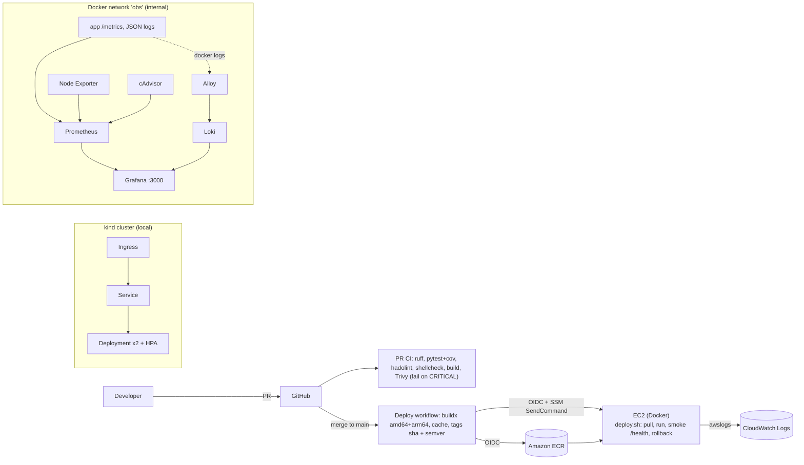

# DevOps Assessment: Service, CI/CD, Terraform, Kubernetes, Observability

A small FastAPI service taken from source to an observable, securely deployed state.
Items marked **TODO(evidence)** need output from your own run (screenshots, logs, sizes).

## 1. Quick start (local)

**Prerequisites:** Docker + Compose v2, Python 3.12 (tests), kind + kubectl (Step 4), Terraform >= 1.10 + AWS CLI (Step 3).

```bash
cp .env.example .env            # set GRAFANA_ADMIN_PASSWORD
docker compose up -d --build                      # app only  -> http://localhost:8080
docker compose --profile monitoring up -d --build # app + full observability
curl localhost:8080/ ; curl localhost:8080/health ; curl localhost:8080/metrics | head
```
Grafana: <http://localhost:3000> (credentials from `.env`) -> folder **DevOps Task** -> Application / Host / Containers.
Generate traffic and errors: `for i in $(seq 200); do curl -s localhost:8080/ >/dev/null; curl -s localhost:8080/boom >/dev/null; done`

### Tests / lint / health script
```bash
python -m venv .venv && . .venv/bin/activate && pip install -r requirements-dev.txt
pytest --cov=app          # unit tests + coverage
ruff check .
shellcheck scripts/system_health.sh
./scripts/system_health.sh --disk 80 --cpu 90 --mem 85 [--json]   # exit 0 ok / 1 warning / 2 critical
```
Scheduling: `scripts/systemd/system-health.{service,timer}` (every 5 min) or `scripts/systemd/crontab.example`.
Optional `HEALTH_WEBHOOK_URL` env var posts warnings to Slack/Discord.

**Final image size:** TODO(evidence) `docker images devops-task:local` (expected ~55-60 MB, Alpine + Python).

## 2. Architecture



## 3. Kubernetes (kind)

```bash
make kind-up                      # kind create cluster
make kind-deploy                  # build, kind load, kubectl apply -k k8s
kubectl -n devops-task create secret generic devops-task-secret --from-literal=API_KEY="$(openssl rand -hex 16)"
kubectl -n devops-task rollout status deploy/devops-task
kubectl -n devops-task port-forward svc/devops-task 8081:80   # port-forward alternative to Ingress
```
Ingress (optional): install ingress-nginx for kind, then use `devops-task.localtest.me`.
HPA needs metrics-server (`kubectl top pods` must work).

**Secrets approach:** no secret values are committed. `k8s/secret.example.yaml` is a template; the real Secret is created with `kubectl create secret`. The Deployment reads it via `secretRef` (optional). Production: External Secrets Operator or Secrets Store CSI Driver backed by AWS Secrets Manager.

### Zero-downtime rolling update and rollback
```bash
docker build -t devops-task:1.0.1 --build-arg VERSION=1.0.1 . && kind load docker-image devops-task:1.0.1 --name devops
# terminal A: continuous traffic from inside the cluster, should show only 200s
kubectl -n devops-task run load --rm -it --image=curlimages/curl --restart=Never -- \
  sh -c 'while true; do curl -s -o /dev/null -w "%{http_code}\n" http://devops-task/health; sleep 0.2; done'
# terminal B
kubectl -n devops-task set image deploy/devops-task app=devops-task:1.0.1
kubectl -n devops-task rollout status deploy/devops-task
kubectl -n devops-task rollout history deploy/devops-task
kubectl -n devops-task rollout undo deploy/devops-task
```
Output: TODO(evidence) paste here. Why it is zero-downtime: `maxUnavailable: 0`, `maxSurge: 1`, readiness probe gates traffic, `preStop` sleep drains endpoints before SIGTERM, app shuts down gracefully.

### How this changes on EKS
- Ingress: AWS Load Balancer Controller (ALB) or ingress-nginx behind an NLB, with ACM TLS.
- Secrets: External Secrets Operator / Secrets Store CSI Driver with AWS Secrets Manager.
- IAM: IRSA (or EKS Pod Identity) per service account, no node-wide permissions.
- Scaling: Karpenter or Cluster Autoscaler for nodes alongside the HPA; PodDisruptionBudget and topology spread across AZs.
- Images from ECR, deployed by Helm/Argo CD; metrics via kube-prometheus-stack.

## 4. Terraform (AWS)

```bash
# one-time: state bucket (S3-native locking via use_lockfile, Terraform >= 1.10)
aws s3api create-bucket --bucket <UNIQUE_STATE_BUCKET> --region us-east-1
aws s3api put-bucket-versioning --bucket <UNIQUE_STATE_BUCKET> --versioning-configuration Status=Enabled
cd terraform
terraform init -backend-config="bucket=<UNIQUE_STATE_BUCKET>" -backend-config="key=staging/terraform.tfstate" -backend-config="region=us-east-1"
terraform plan  -var-file=envs/staging.tfvars
terraform apply -var-file=envs/staging.tfvars
# production: re-init with -reconfigure and key=production/terraform.tfstate, then use envs/production.tfvars
terraform destroy -var-file=envs/staging.tfvars   # when finished
```
Edit `github_repo` in the tfvars to `amirhamza0110-eng/Devops-task`. Resources: EC2 (AL2023, IMDSv2, encrypted gp3) in the default VPC, SG with only port 80 (no SSH; SSM for access), instance profile with least privilege (ECR pull on one repo, logs write on one log group, SSM core), ECR repo (immutable tags, scan on push, lifecycle), CloudWatch log group with retention, GitHub OIDC role. Docker `awslogs` driver ships container logs.
Evidence: TODO(evidence) `terraform plan` / `apply` output or screenshots.

## 5. CI/CD configuration

| Kind | Name | Value |
|---|---|---|
| Repo variable | `AWS_REGION` | e.g. `us-east-1` |
| Repo variable | `AWS_ROLE_ARN` | terraform output `ci_role_arn` |
| Repo variable | `ECR_REPOSITORY` | terraform output `ecr_repository` |
| Repo variable | `EC2_INSTANCE_ID` | terraform output `instance_id` |
| Repo variable (optional) | `DEPLOY_ENVIRONMENT` | `staging` or `production` (GitHub Environment, add required reviewers on production) |
| Secrets | none | OIDC means no AWS keys; nothing hardcoded |

Tags pushed: `sha-<full sha>`, `sha-<12 chars>` (what is deployed) and semver `MAJOR.MINOR.<run number>` (MAJOR.MINOR from `VERSION`). ECR tags are immutable. Evidence of a successful deploy run: TODO(evidence).

If GitHub Actions reports `Not authorized to perform sts:AssumeRoleWithWebIdentity`, update the IAM trust policy by applying the staging Terraform configuration (`cd terraform && terraform apply -var-file=envs/staging.tfvars`). The trust policy allows the repository name in its configured and lowercase forms, and is restricted to this repository's `main` branch and staging/production environments. Confirm the workflow has `id-token: write` and uses the `ci_role_arn` output.

## 6. Observability

- **Metrics:** Prometheus scrapes app, Node Exporter, cAdvisor; retention 15d / 2GB.
- **Logs:** Alloy discovers containers through the Docker socket and ships to Loki (7d retention). The app JSON is parsed; only `level` and `path` are promoted to labels next to `container` and `service`. `path` is the route template (unknown URLs become `unmatched`), so cardinality is bounded. `status`, `duration_ms`, `method` stay inside the line and are filtered with `| json`, since high-cardinality values as labels would blow up Loki's index.
- **Dashboards (as code, `monitoring/grafana/dashboards/*.json`, generated by `scripts/gen_dashboards.py`):** Application (rate, 5xx ratio, p50/p95/p99, Loki error logs and all logs on the same page), Host, Containers (CPU, memory, memory vs limit). Screenshots: TODO(evidence) add to `docs/`.
- **Hygiene:** Grafana credentials come from env (`.env`, required by Compose). Only Grafana publishes a port; the others are on an `internal: true` network. All images are pinned.
- **Privileges:** Node Exporter: `pid: host` and `/` mounted read-only (`rslave`) for host metrics. cAdvisor: read-only mounts of `/`, `/var/run`, `/sys`, `/var/lib/docker`, plus `/dev/kmsg`; not `privileged`. Alloy: read-only Docker socket, which is effectively root-equivalent on the host, so in production use a socket proxy or the file-based log driver. Docker Desktop (Mac/Windows) may limit host and cAdvisor metrics.

### Alert thresholds
| Alert | Condition | for | Reasoning |
|---|---|---|---|
| AppInstanceDown | `up == 0` | 1m | 4 missed scrapes: ignores one blip, fast enough to matter |
| HighErrorRate | 5xx ratio > 5% (and > 0.1 rps) | 5m | Sustained user impact, traffic guard avoids noise at idle |
| HostDiskUsageHigh | > 80% | 10m | Disks fill slowly, 10m avoids flapping |
| ContainerMemoryNearLimit | working set > 90% of limit | 5m | Headroom before OOM-kill, filters spikes |
| HighLatencyP95 | p95 > 500ms | 10m | Degradation without a hard failure |

### Walkthrough: "An error spike appears on the Application dashboard. How do you find the cause?"
1. On **Application**, note the spike time and which `path` series carries the traffic; check whether latency rose with it.
2. In the **error logs panel** (same time range) read the failing lines: `{service="app", level="error"}`, then `| json | status=500` in Explore to see path and duration.
3. Find out what changed: was there a deploy (the `version` in `/`, or CI run time)? If the spike starts right at a rollout, roll back.
4. Check **Containers**: memory near its limit or CPU throttling or restarts (cAdvisor) point at resource exhaustion or OOM kills.
5. Check **Host** for disk, CPU, or network saturation.
6. Fix or roll back, then confirm the 5xx ratio returns to normal and the alert resolves.

## 7. Design decisions
- **Alpine vs distroless:** Alpine for a debuggable shell, small size, and a simple Python healthcheck. Distroless would cut attack surface further but makes debugging harder; musl can bite with some wheels. Trade-off accepted for this scope.
- **EC2 vs ECS vs EKS:** EC2 + SSM is the simplest thing that satisfies the task and Free Tier. ECS/Fargate would remove host management; EKS is justified only for many services or Kubernetes-native tooling.
- **Tagging:** immutable `sha-` tags for deployment and rollback; semver for humans; never rely on `latest`.
- **Secrets:** OIDC for CI, instance profile for AWS access, Secrets Manager (or ESO) for app secrets; nothing in git.
- **Log labels:** `level`, `path`, `container`, `service` only (see above).
- **Alerting in Prometheus rules** (no Alertmanager yet) to keep the stack small.

## 8. Deployment & rollback strategy
Release path: PR (lint, tests, scan) -> merge -> immutable multi-arch image -> SSM runs `deploy.sh` on the host (pull, start, smoke-test `/health`). **Automatic rollback:** if the smoke test fails, the script restarts the previously running image tag and exits non-zero, failing the workflow. **Manual rollback:** re-run `deploy.sh` with any earlier `sha-` tag via SSM. Production should use a GitHub Environment with required approval. Kubernetes: `kubectl rollout undo`.

## 9. Security considerations
- **Secrets:** no static AWS keys (OIDC and instance profile), no secrets in git, `.env` ignored, K8s Secret created out of band.
- **Image scanning:** Trivy fails PRs on CRITICAL; ECR scan on push; pinned base image; non-root, read-only root fs, dropped capabilities, no-new-privileges.
- **IAM:** CI role limited to one repo and the `main` branch, push to one ECR repo, SSM on one instance. Instance role limited to pull from one repo and write to one log group.
- **Network:** only port 80 open, no SSH, IMDSv2 required, observability ports internal only. Production should add HTTPS (ALB + ACM) and restrict CIDRs.

## 10. Rough monthly AWS cost (production, us-east-1, on-demand)
| Item | ~USD |
|---|---|
| EC2 t3.small (730h) | 15 |
| EBS 8GB gp3 | 1 |
| Public IPv4 | 3.7 |
| CloudWatch Logs (few GB) | 2 to 3 |
| ECR + S3 state | < 1 |
| **Total** | **~22 to 25** (staging on t3.micro ~13). An ALB would add ~17 to 20. |

## 11. What I would improve with more time
Alertmanager with Slack routing; HTTPS via ALB + ACM; blue/green or canary; Cosign signing + SBOM; Helm chart with staging/prod values; kube-prometheus-stack; tracing with OpenTelemetry/Tempo; Ansible hardening; Terraform modules and CI `terraform plan` on PRs; socket proxy for Alloy; run the monitoring stack in Kubernetes.


